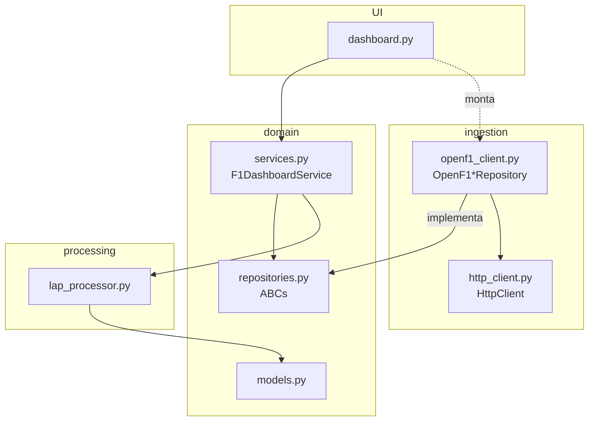

# Arquitetura

O projeto segue uma **arquitetura em camadas**. A regra principal é a direção das dependências:

```
UI (dashboard.py)  ->  domain  <-  ingestion
                         ^
                         |
                     processing
```

O `domain` define **o que** o sistema precisa (modelos e interfaces). As outras camadas dizem **como**.



## Camadas

### `domain/`
- **`models.py`**: entidades Pydantic (`Meeting`, `Session`, `Driver`, `Lap`, `FastestLapEntry`, `SessionSummary`). São imutáveis e ignoram campos extras da API.
- **`repositories.py`**: contratos abstratos (`MeetingRepository`, `SessionRepository`, `DriverRepository`, `LapRepository`).
- **`services.py`**: `F1DashboardService` recebe os quatro repositórios pelo construtor e devolve dados prontos para a tela.

### `processing/`
`lap_processor.py` tem só **funções puras**: mesma entrada, mesma saída, sem rede nem disco.

| Função | O que faz |
|---|---|
| `filter_valid_laps` | remove voltas sem tempo e de saída de box |
| `build_driver_index` | `{numero_do_carro: Driver}` |
| `best_lap_per_driver` | melhor volta de cada piloto |
| `compute_top_n_laps` | ranking com posição e gap para o primeiro |
| `average_lap_time` | média do ranking |
| `format_lap_time` / `format_gap` | `1:32.345` / `+0.244` |
| `to_table_rows` / `rows_to_csv` | linhas para tabela e CSV |

### `ingestion/`
- **`HttpClient`**: encapsula o `httpx.Client` com timeout, **retry com backoff exponencial** (timeout, erro de rede, 429 e 5xx) e trata **404 como lista vazia** (é assim que a OpenF1 responde quando não há resultado).
- **`OpenF1*Repository`**: montam os parâmetros de cada endpoint e validam os itens. Itens inválidos são **logados e ignorados**, para um registro ruim não derrubar a consulta inteira.

### `dashboard.py`
É o *composition root*: cria o `HttpClient`, os repositórios e o serviço, e desenha a tela. Usa `st.cache_resource` para o serviço e `st.cache_data` (TTL de 1 hora) para as consultas.

## Por que assim?

- **Testabilidade**: o serviço pode ser testado com repositórios falsos; o processamento, sem mock nenhum.
- **Troca de fonte**: para ler de um CSV ou banco, basta escrever outro repositório.
- **Resiliência**: falhas temporárias da API são repetidas automaticamente, e o usuário vê uma mensagem clara se ainda assim não der certo.
