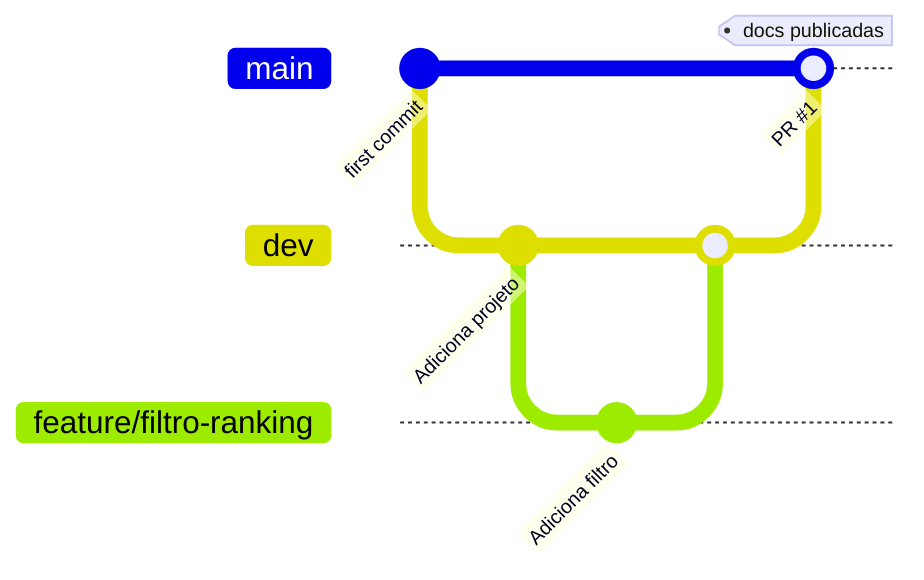

# Contribuindo

## Fluxo de branches



- `main`: versão estável. Cada push publica a documentação.
- `dev`: integração das mudanças.
- `feature/<nome>`: uma branch por funcionalidade.

## Antes de commitar

Instale os hooks uma vez:

```bash
poetry run pre-commit install
```

A partir daí, cada `git commit` roda Ruff (lint + formatação) e checagens de YAML/TOML automaticamente. Para rodar manualmente em tudo:

```bash
poetry run pre-commit run --all-files
```

## Checklist do Pull Request

- [ ] `poetry run task lint` sem erros
- [ ] `poetry run ruff format . --check` sem diferenças
- [ ] `poetry run task test` verde, cobertura ≥ 50%
- [ ] Documentação atualizada, se mudou comportamento
- [ ] Sem `.env`, senhas ou tokens no commit

## Modelo de descrição

```markdown
## O que foi feito
## Por que foi feito
## Como testar
## Checklist
```

## Padrões

Os padrões completos (camadas, nomes, logging, testes) estão em `.claude/SKILL.md`.
