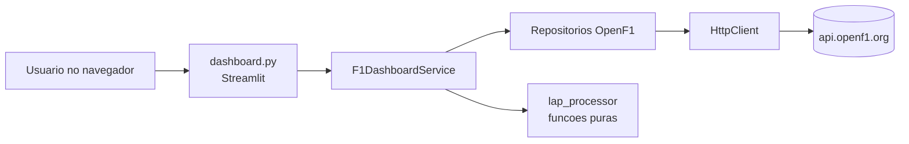

# F1 Dashboard

Dashboard interativo que mostra **as voltas mais rápidas de cada circuito** da Fórmula 1, com dados históricos gratuitos da [API OpenF1](https://openf1.org) (temporadas de 2023 em diante).

## O que dá para fazer

- Escolher **temporada → Grande Prêmio → sessão** (treinos, classificação, sprint ou corrida).
- Ver o **ranking das N voltas mais rápidas** (de 3 a 20), com as cores de cada equipe.
- Alternar entre o ranking absoluto e **uma volta por piloto** (a melhor de cada um).
- Comparar **gap para o primeiro**, tempos de **setor** e velocidade no **speed trap**.
- Baixar o ranking em **CSV**.

## Como funciona em uma frase

O dashboard pede os dados para a OpenF1, descarta voltas sem tempo e voltas de saída de box, ordena pelo tempo e desenha o resultado.



## Começo rápido

```bash
poetry install --with dev,docs
poetry run task app
```

Abra <http://localhost:8501>. Detalhes em [Rodando localmente](running-locally.md).

## Tecnologias

| Para quê | Ferramenta |
|---|---|
| Dependências e ambiente | Poetry |
| Interface | Streamlit + Plotly |
| HTTP | httpx (com retry e backoff) |
| Modelos de dados | Pydantic v2 |
| Lint e formatação | Ruff + pre-commit |
| Testes | pytest, pytest-cov, pytest-mock |
| Documentação | MkDocs Material |
| CI/CD | GitHub Actions + GitHub Pages |
